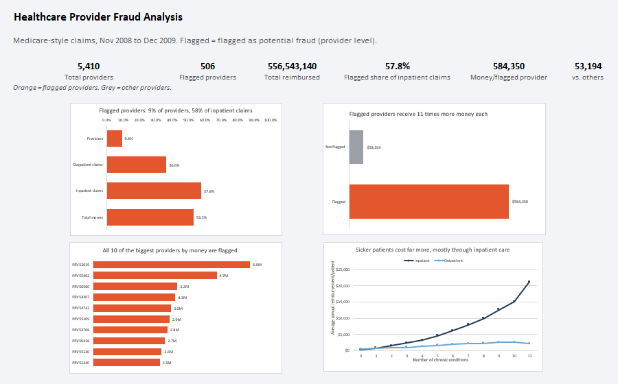

# Healthcare Provider Fraud Detection Analysis

> Identifying which healthcare providers look suspicious by analysing Medicare-style insurance claims with **Excel (Power Query, PivotTables)** and **SQL Server (T-SQL)**.


<!-- Add the dashboard screenshot here once the Excel dashboard is finished -->

## Project status

- [x] Dataset selected and data dictionary written
- [x] Beneficiary file cleaned (Excel Power Query)
- [ ] Inpatient file cleaned
- [ ] Outpatient file cleaned
- [ ] Provider labels cleaned
- [ ] SQL database built and data quality checks run
- [ ] SQL analysis queries
- [ ] Excel analysis workbook and dashboard
- [ ] Business questions answered

## Business problem

Health insurers lose a large amount of money to fraudulent billing. Reviewing every provider by hand is not realistic, so analysts look for patterns that separate providers flagged as potentially fraudulent from the rest. This project asks: **which claim and patient characteristics are associated with potentially fraudulent providers, and where should an investigation team look first?**

## Dataset

- **Source:** Kaggle, "Healthcare Provider Fraud Detection Analysis" ([link](https://www.kaggle.com/datasets/rohitrox/healthcare-provider-fraud-detection-analysis)).
- **Content:** Medicare-style claims data in four files.

| File | Rows | What it holds |
| --- | --- | --- |
| Beneficiary | 138,556 | One row per patient: demographics, coverage, chronic conditions, annual amounts |
| Inpatient | 40,474 | One row per hospital-stay claim |
| Outpatient | 517,737 | One row per outpatient claim |
| Provider labels | 5,410 | One row per provider with a `PotentialFraud` label (Yes 506, No 4,904) |

The files link through `BeneID`, `Provider` and `ClaimID`. Full column descriptions are in [`docs/data_dictionary.md`](docs/data_dictionary.md).

> The raw data is **not** stored in this repository because of its size. Download it from Kaggle and place the files in `data/raw/` (see [`data/README.md`](data/README.md)).

## Tools

| Tool | Used for |
| --- | --- |
| Excel (Power Query) | Cleaning and transforming the files, with every step recorded |
| Excel (PivotTables, charts) | Exploratory analysis and the dashboard |
| SQL Server (T-SQL) | Building the database, data quality checks, analysis queries |
| GitHub | Version control and portfolio |

## Repository structure

```
.
├── README.md
├── data/
│   ├── README.md              # where to download the data and how to use it
│   ├── raw/                   # original Kaggle files (not committed)
│   ├── processed/             # cleaned files (not committed if large)
│   └── sample/                # small sample of each cleaned file
├── sql/                       # numbered scripts: setup, quality checks, analysis
├── excel/                     # analysis workbook and dashboard
├── docs/
│   ├── data_dictionary.md     # columns, codes, cleaning steps
│   ├── business_questions.md  # questions and answers
│   └── assumptions_and_limitations.md
└── images/                    # dashboard and ERD screenshots
```

## Data preparation

Cleaning was done in Excel Power Query so every step is recorded in Applied Steps. Beneficiary file summary (full log in the data dictionary):

- Replaced numeric codes with text: gender, race, the 11 chronic condition flags and the renal disease indicator. State and County were left as codes.
- Standardised column names (`ChronicCond_DiseaseName`) and fixed a source spelling error (`Osteoporasis` to `Osteoporosis`).
- Replaced the text `NA` in the date-of-death column with null (blank means the patient is alive) and set correct data types.
- Trimmed extra spaces, checked for duplicate `BeneID` values, and formatted amount columns as currency.
- Kept negative reimbursement amounts (IP: 15 rows, OP: 12 rows) and patients with 0 months of coverage, and added flag columns (`NegativeIPFlag`, `NegativeOPFlag`, `ZeroPartAFlag`, `ZeroPartBFlag`) instead of deleting them.

Inpatient, outpatient and provider files: `[add a short summary when done]`

## Analysis

### SQL

`[Describe what each script does once written, e.g. 01_create_tables.sql, 02_data_quality_checks.sql, ...]`

### Excel

`[Describe the workbook: sheets, PivotTables, dashboard]`

## Key findings

`[Fill in with your real numbers. Suggested format: one sentence per finding with a figure.]`

1. `[Finding 1, e.g. share of claims and reimbursement amount from flagged providers]`
2. `[Finding 2]`
3. `[Finding 3]`

## Recommendations

`[2 or 3 actions an investigation team could take, tied to your findings.]`

## How to reproduce

1. Download the dataset from Kaggle and place the four files in `data/raw/`.
2. Open the Excel workbook and refresh the Power Query connections (point them to your `data/raw/` folder).
3. Run the scripts in `sql/` in numbered order on SQL Server.

## Limitations

- Fraud labels are provider-level, not claim-level, so a flagged provider's legitimate claims are labelled too.
- Code meanings (gender, race, conditions) follow the CMS convention and are an assumption until confirmed in the CMS codebook.
- `[Add anything else you discover.]`

## Skills demonstrated

Data cleaning with Power Query, data dictionary and documentation, relational data modelling, T-SQL (joins, CTEs, window functions), PivotTables and dashboard design, business storytelling.

## Author

**[Saga Haggag]**, pharmacy graduate moving into data analytics.
[LinkedIn](https://www.linkedin.com/in/saga-mohamed-970111144) | [GitHub](https://github.com/sagahaggag)
