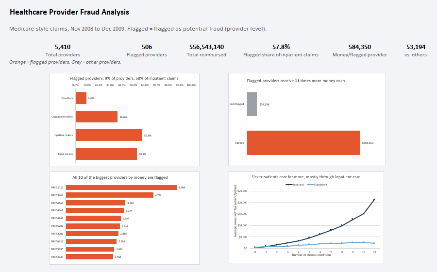

# Business Questions

Answers to the business questions, using the SQL queries in [`sql/04_analysis_queries.sql`](../sql/04_analysis_queries.sql) and the Excel dashboard in [`excel/fraud_dashboard.xlsx`](../excel/fraud_dashboard.xlsx).

> `PotentialFraud` is a provider-level label, so every finding below is an association, not proof of fraud.

## 1. How common are flagged providers?

**506 of 5,410 providers (9.35%) are flagged.** (Query 1)

## 2. How much of the claims and money do they account for?

| Claim type | Flagged share of claims | Flagged share of money |
| --- | --- | --- |
| Inpatient | 57.8% | 59.1% |
| Outpatient | 36.6% | 36.7% |
| All claims | | 53.1% (295.7 million of 556.5 million) |

Flagged providers are 9.4% of providers but receive more than half of all the money. (Queries 2 and 4)

## 3. Who are the biggest providers?

**All 10 providers who received the most money are flagged.** The largest, PRV52019, received 5,996,050 over 1,961 claims. (Query 3)

## 4. Are flagged providers just busier, or are their claims bigger?

- Average claim size is similar: inpatient 10,311 (flagged) vs 9,783, outpatient 287 vs 286.
- But per provider, flagged providers bill about 6 times more claims (420.55 vs 70.44) and receive about 11 times more money (584,350 vs 53,194).

The gap comes mainly from claim volume per provider and from a larger share of high-value inpatient claims, not from larger individual claims. (Queries 2, 4 and 6)

## 5. Do flagged providers keep patients in hospital longer?

**No meaningful difference.** The average stay is 5.74 days for flagged providers and 5.56 days for the rest (5.67 overall). The gap of about 4 hours is too small to treat as a signal. (Query 5)

## 6. What drives the cost of a patient?

**The number of chronic conditions, mostly through inpatient care.** Average annual inpatient reimbursement rises from 273 for patients with no conditions to 15,022 for patients with 10, about 55 times more. Outpatient cost rises about 5 times over the same range (485 to 2,595). (Query 7)

## Recommendations

1. **Start with inpatient claims from the largest flagged providers.** About 82% of the money paid to flagged providers is inpatient, and the top 10 providers by money are all flagged.
2. **Review providers by claim volume.** Flagged providers bill about 6 times more claims per provider, so unusually high volume is a useful screening rule.
3. **Account for patient mix in a next step.** Sicker patients cost far more, so comparing providers fairly needs the number of chronic conditions of their patients taken into account.

## Limitations

See [`assumptions_and_limitations.md`](assumptions_and_limitations.md).
